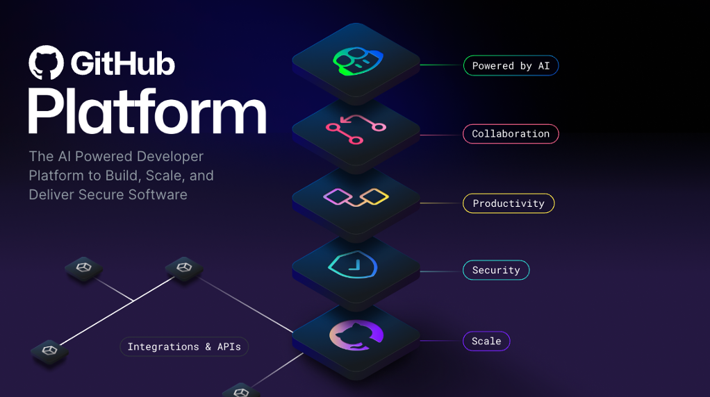
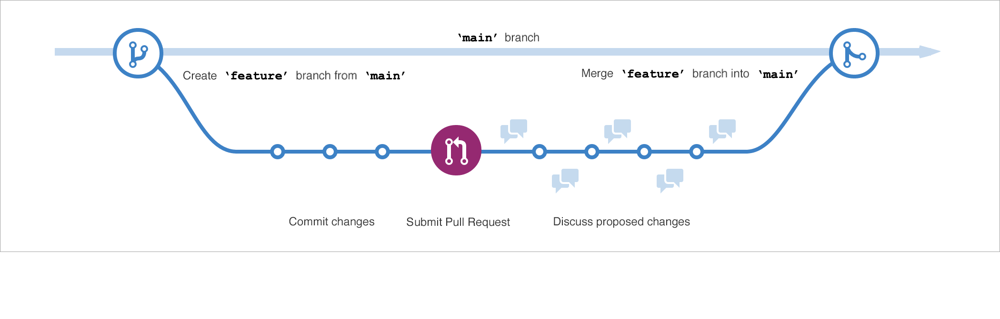
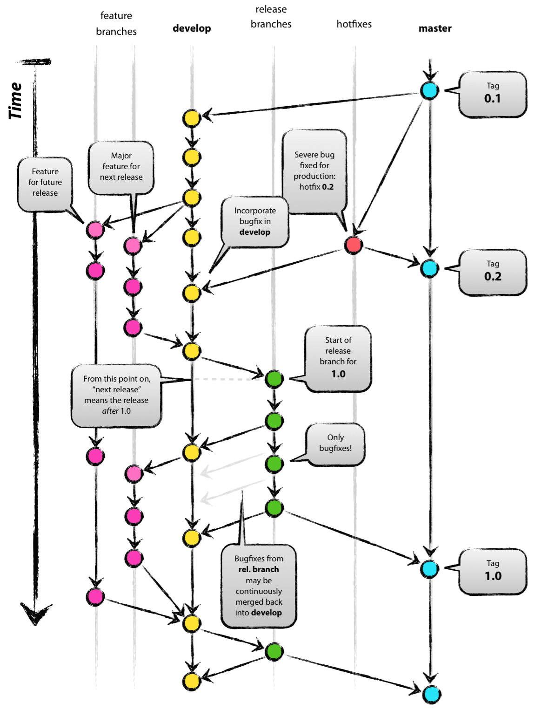

# What is GitHub
Github é uma plataforma construída em cima de Git.
Git é um sistema de controle de versão construpido para identificar mudanças, colaborações e código e gerenciamento de revisões ao longo do tempo.



O github é uma plataforma baseada em nuvem que utiliza o git, que simplifica o processo de colaboração nos projetos e prove um website, ferramentas de linha de comando, e o fluxo geral que permique que desenvolvedores e usuários trabalhem juntos.


#### AI
A Plataforma GitHub Enterprise prove algumas ferramentas de colaboração como Copilot, Copilot Chat e Copilot Agents.


# Introduction to Repositories
What is a repository?
How to create a repository
Adding files to a repository
How to search for repositories

Todas as questões acimas podem ser visualizadas na documentação do GitHub.


## Github Gists
É uma funcionalidade do GitHub que te permmite compartilhar partes do código, notas ou outras pequenas informações. São como mini repositórios, então você pode clonar, forkar e tudo que há em um repositório comum. 

**Public Gists**: São visíveis para todo mundo e podem ser descobertos através do GitHub's search. São ideais para compartilhar trechos de códigos ou soluções que você deseja deixar disponível para comunidade.

**Secret Gists**: Essa opção não é pesquisável ou listada publicamente, mas não são inteiramente privado. Qualquer pessoa com a URL pode acessar. São úteis para compartilhar código com uma audiência limitada. 


# Unit 3
## O que são branches?
Uma "branch" é um ramo da branch principal. Vamos pensar que o código é uma linha contínua, e as branchs são linhas filhas que andam em paralelo da linha principal.

A branch main contém o código principal, você pode criar uma branch a partir da main e trabalhar seu código em cima dela sem que o conteúdo da main seja alterado.
Suas mudanças só serão aplicadas na branch principal, se você realizar o merge.


### O que são commits?
Commits são mudanças de um ou mais arquivos na branch. Cada commit é registrado com um único ID, horário e contribuidor. Commits provem uma auditoria clara para qualquer pessoa revisando o histórico de arquivos ou correlatos, como issues ou pull requests.

Em um repositório git, podemos ter diferentes tipos de estados nos arquivos. Os estados primários são Untracked e Tracked.

**Untracked**: o estado inicial de um arquivo que ainda não faz parte do repositório do Git, ou seja, ele ainda não foi identificado/adicionado ao repositório.
*Exemplo: criei um no arquivo porém ainda não dei um "git add file.name, para adicioná-lo ao repositório.*

**Tracked**: é um arquivo em que o git está monitorando e sabe que existe.
- Unmodified: Está no track porém não foi modificado desde o último commit.
- Modified: o arquivo mudou desde o último commit porém ainda não foram adicionados ao novo commit.
- Staged: arquivos mmodificados, que foram adicionados a fila para serem commitados.
- Commited: o arquivo está no respositório database. 





## Tipo de Branch
- master: sempre reflete o código de produção
- develop: contém o último trabalho de desenvolvimento para a próxima release
- feature/*: usada para criar novas features, é uma branche criada da de develop e mergeada quando completa. (merge to develop NOT to main)
- release/*: Prepara a release de produção da develop
- hotfix/*: usada para corrigir um erro em produção.

```javascript
var first = 1;
var second = 2;
var sum = first + second;
```